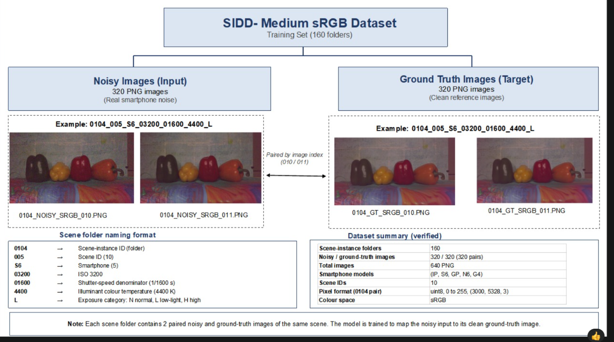
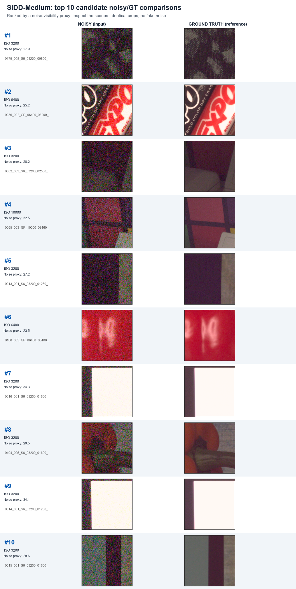

# SIDD-Image-Denoising-sRBG-medium
# SIDD-Medium sRGB · Real-World Image Denoising

**Research record · Dataset engineering · Paired-image analysis · Reproducible experiments**

**Maintainer and dataset research workstream lead:** [@Tanika-git](https://github.com/Tanika-git)  
**Course:** Image and Video Processing  
**Local research evidence:** October 21, 2026 · **Repository documentation prepared:** October 28, 2026  
**Status:** Dataset investigation documented; model training and research improvement not yet established.

> **Project direction** — Build from a verified real-world smartphone denoising dataset toward controlled U-Net/NAFNet reference experiments, followed by an independent research implementation and testable improvement. Completed dataset analysis and planned model experiments are distinguished throughout.

*Dataset-structure diagram supplied by the repository maintainer. Example image content is from SIDD; see [scientific attribution](docs/07_SCIENTIFIC_SOURCES_AND_ATTRIBUTION.md).*

## Research work completed and documented

| Research contribution | Evidence | State |
|:--|:--|:--|
| Selected, acquired and investigated the SIDD-Medium sRGB training set | [Dataset acquisition report](docs/01_DATASET_ACQUISITION_AND_STRUCTURE.md) | Documented from local evidence |
| Inventoried **160 scene-instance folders, 320 noisy images, 320 clean GT images** | [Original PowerShell verification](docs/02_PAIR_VERIFICATION_AND_CODE.md) | Recorded October 21 |
| Examined RGB/uint8 formats, dimensions, brightness statistics and approximate pair alignment | [Original Python source](scripts/check_sidd_pixels.py) · [analysis notes](docs/04_PIXEL_AND_QUALITY_INSPECTION.md) | Original code supplied |
| Profiled camera, ISO, lighting, color temperature and scene distributions | [Metadata report](docs/03_DATASET_PROFILING.md) · [160-scene CSV](analysis/scene_instance_metadata.csv) | Recalculated from original CSV |
| Prepared and inspected a **320-record pair-ranking analysis** and top-10 visual comparison | [Ranking CSV](analysis/SIDD_Pair_Ranking.csv) · [figure](assets/sidd_top10_candidate_pairs.png) | Preliminary heuristic, not model results |
| Developed explanatory dataset diagrams and research presentation | [Structure illustration](assets/sidd_medium_srgb_diagram.png) | Original artifacts supplied |

### Verified structure from the supplied research records

| 160 scene-instance folders | 320 noisy/clean pairs | 640 expected PNG files | 5 camera codes |
|:--:|:--:|:--:|:--:|
| Metadata inventory | Paired filename matches | 320 noisy + 320 GT | IP, S6, GP, N6, G4 |

The supplied 320-row CSV contains two distinct paired records for each of 160 folder names. Its noisy-to-GT relative filename mappings are internally consistent. **It does not replace a new Colab integrity scan that opens every original image and checks dimensions.** The official dataset authors describe SIDD-Medium as 320 noisy/GT pairs from 160 scene instances.

## Dataset profiling · 160 scene-instance folders

| Camera distribution | Lighting distribution |
|:--:|:--:|
|  |  |

[Full ISO distribution](assets/iso_distribution.png) · [Detailed profiling report](docs/03_DATASET_PROFILING.md)

The pronounced imbalance in capture conditions motivates **stratified diagnostic analysis**, not claims of model performance. All comparisons will use a consistent split to avoid leakage between related captures.

## Noise exploration: selected paired examples

The following figure juxtaposes identically located noisy and reference crops from 10 candidates identified during exploratory ranking. **These are noisy inputs and ground truth, NOT denoised model predictions.** Ranking scores are local heuristic values whose implementation still needs to be audited.

<strong>View the top-10 noisy/GT visual comparison</strong>

[Original 320-record ranking CSV](analysis/SIDD_Pair_Ranking.csv) · [Sanitized selected records](analysis/sidd_ranked_pairs_public.json) · [Ranking limitations](analysis/README.md)

## Experimental roadmap

| Workstream | Objective | Status |
|:--|:--|:--|
| A. Existing team baselines | Validate and run U-Net and standard NAFNet on SIDD, with saved configs/checkpoints and fair PSNR/SSIM comparison | **Not yet verified as executed** |
| B. Independent implementation | Develop the maintainer's own data loader, PyTorch model code, training, checkpointing and evaluation | **Planned / in progress** |
| C. Method investigation | Review an adaptive-gating hypothesis suggested by course notes; design controlled ablations if sufficiently justified | **Research question only** |
| D. Research reporting | Interpret results and report limitations honestly | **Awaiting training evidence** |

Research context: [U-Net](https://arxiv.org/abs/1505.04597) · [NAFNet / Simple Baselines for Image Restoration](https://arxiv.org/abs/2204.04676). An existing [team baseline repository](https://github.com/nitya-goyal/SOTA-Image-Denoising) is credited as its own implementation; its code is **not represented as this repository maintainer's code**.

## Navigate this research repository

- [01 — Dataset acquisition and organization](docs/01_DATASET_ACQUISITION_AND_STRUCTURE.md)
- [02 — Noisy/GT file pairing and executable checks](docs/02_PAIR_VERIFICATION_AND_CODE.md)
- [03 — Camera, lighting and ISO metadata analysis](docs/03_DATASET_PROFILING.md)
- [04 — Pixel-level inspection and reference-quality measurements](docs/04_PIXEL_AND_QUALITY_INSPECTION.md)
- [05 — Baselines, independent implementation and research hypotheses](docs/05_EXPERIMENTAL_METHODOLOGY.md)
- [06 — Dated evidence and research timeline](docs/06_DATED_RESEARCH_LOG.md)
- [07 — Original research sources and attribution](docs/07_SCIENTIFIC_SOURCES_AND_ATTRIBUTION.md)
- [08 — Professor review briefing](docs/08_PROFESSOR_REVIEW.md)
- [09 — Dataset storage and reproducibility policy](docs/09_REPRODUCIBILITY_AND_STORAGE.md)
- [Original and adapted inspection scripts](scripts/README.md)
- [Contributions and ownership record](CONTRIBUTIONS.md)
- [Experiment register](experiments/README.md)

## Reproducibility boundaries

The original multi-GB image dataset and training checkpoints remain **on local storage and/or Google Drive**, not in this GitHub repository. This repo contains small source files, inspected metadata, and shareable analysis figures. Future model metrics will be committed only with corresponding run configurations, checkpoint identities and actual evaluation outputs.

**Credit:** Dataset copyright and citation remain with its original scientific authors; separately created team baseline code is credited to its actual contributors. This personal repository is maintained by @Tanika-git. Official team leadership and future publication author order are not established by repository ownership alone.

