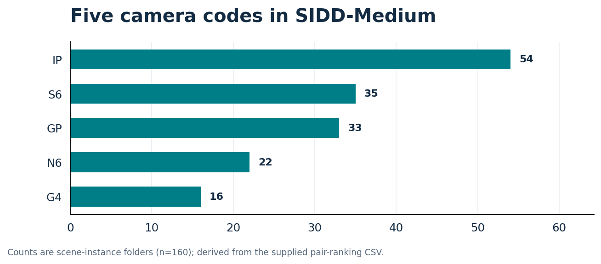
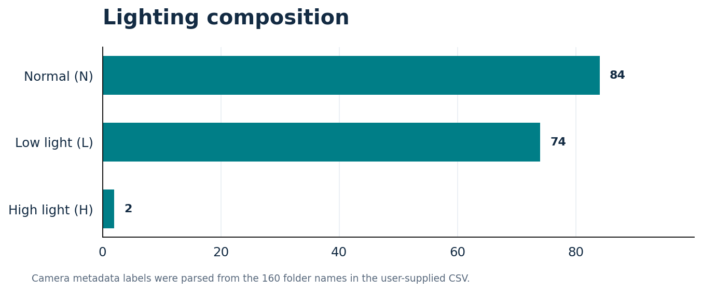
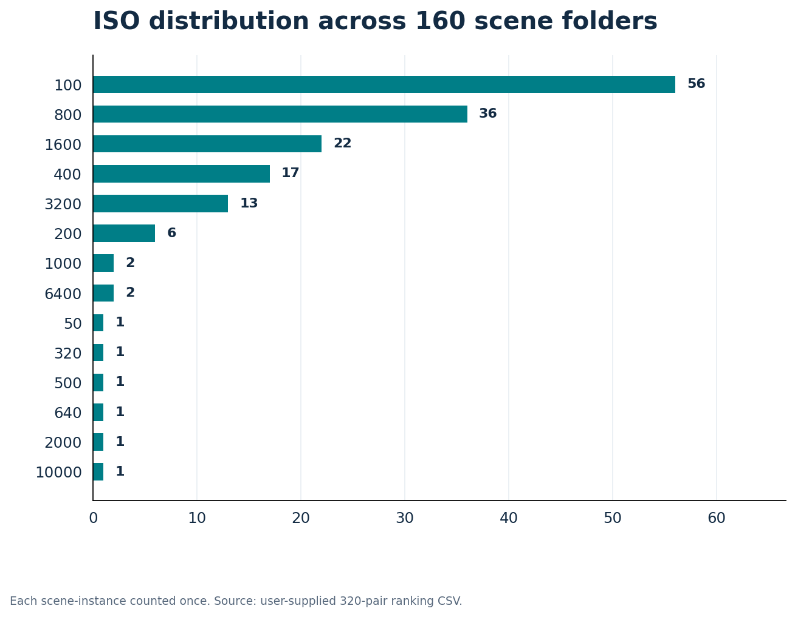

# 03 — Camera, ISO, Lighting and Scene Profiling

**Source:** Metadata parsed from the maintainer's original **320-row ranking CSV**. All counts here are per unique scene-instance folder (**n=160**), not per image.

## Smartphone codes

| Camera code | Folders |
|---|---:|
| IP | 54 |
| S6 | 35 |
| GP | 33 |
| N6 | 22 |
| G4 | 16 |

## Lighting

| Lighting code | Folders |
|---|---:|
| N (normal) | 84 |
| L (low light) | 74 |
| H (high light) | 2 |

Only **two** folders carry the high-light label. This is a descriptive limitation of the dataset slice, not a measurement of model generalization.

## Color-temperature codes (K)

| Color temperature | Folders |
|---|---:|
| 3200 | 55 |
| 4400 | 35 |
| 5500 | 70 |

## ISO code frequency

| ISO | Folders |
|---:|---:|
|    50 |   1 |
|   100 |  56 |
|   200 |   6 |
|   320 |   1 |
|   400 |  17 |
|   500 |   1 |
|   640 |   1 |
|   800 |  36 |
|  1000 |   2 |
|  1600 |  22 |
|  2000 |   1 |
|  3200 |  13 |
|  6400 |   2 |
| 10000 |   1 |

## Physical scene ID frequency

| Scene ID | Folders |
|---|---:|
| 001 | 28 |
| 002 | 15 |
| 003 | 15 |
| 004 | 15 |
| 005 | 19 |
| 006 | 19 |
| 007 | 20 |
| 008 | 20 |
| 009 | 6 |
| 010 | 3 |

## Method and implications

The original ranking has 320 paired records. Dropping repeated folder names leaves 160 folder rows. The underscore-delimited naming tokens were parsed for scene ID, camera code, ISO, color temperature and lighting. The computed results agree with the supplied terminal screenshots for all shown distributions.

Model selection and evaluation should avoid placing captures of the same underlying physical scene in both training and holdout partitions. A scene-disjoint split is a **planned protocol**, not a split claimed to have been completed.
