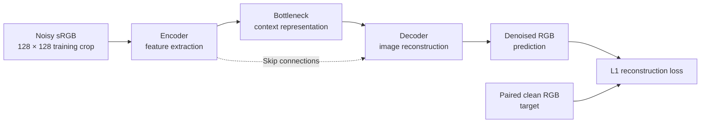
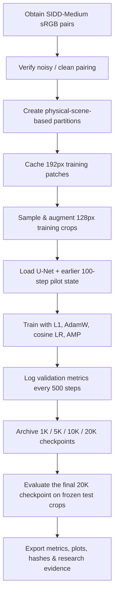

<div align="center">
# U-Net Training & Evaluation — Original Research Experiment by @Tanika-git

**Researcher and U-Net Training Lead:** [@Tanika-git](https://github.com/Tanika-git)

**Experiment:** SIDD-Medium sRGB Image Denoising

**Status:** COMPLETED — 20,000 Successful Optimizer Updates

**Training Completion:** 3 November 2026

## Original Training and Individual Contribution Attribution

**The U-Net model documented in this experiment was adapted, trained, monitored, checkpointed, evaluated and documented by @Tanika-git.**

I independently carried out the recorded U-Net training experiment, from the initial pilot through the completed 20,000-step training milestone, using Kaggle GPU resources.

The initial reference implementation was provided by research teammate Nitya Goyal. I adapted the code for my SIDD-Medium sRGB experiment and personally performed the subsequent training and evaluation work.

### My Individual Contributions

- Adaptation and configuration of the U-Net experimental implementation.
- SIDD-Medium sRGB data preparation and experimental organization.
- Kaggle training workflow setup and troubleshooting.
- Training configuration, optimizer, loss and scheduling setup.
- Pilot training and completion of the 20,000-step experiment.
- Training monitoring and checkpoint preservation.
- Experimental logs, histories and configuration management.
- Validation analysis and performance tracking.
- Held-out test evaluation and PSNR/SSIM result generation.
- Training visualizations and research documentation.
- Original experiment provenance and evidence preservation.

### Completed Experimental Results

| Measurement | Recorded result |
|---|---:|
| Successful optimizer updates | 20,000 |
| Validation PSNR | **36.533 dB** |
| Validation SSIM | **0.90064** |
| Held-out test PSNR | **41.232 dB** |
| Held-out test SSIM | **0.95286** |
| Evaluated checkpoint | `step_020000.pt` |

The results above are from the documented internal evaluation protocol, not the official SIDD benchmark.

## Model Provenance and Attribution

**Original U-Net experiment and trained checkpoint: @Tanika-git**

**Training execution, checkpoint management, evaluation and documented experimental results: @Tanika-git**

**Starting/reference implementation provided by: Nitya Goyal**

The original trained model and recorded U-Net experimental results are attributed to @Tanika-git as the researcher responsible for the documented training experiment.

### Research Sharing

**Research collaborators and checkpoint recipients:** Nitya Goyal and Kannu Goyal.

**Purpose:** Private academic research and U-Net versus NAFNet comparison.

The trained model is shared for collaborative research. Sharing the checkpoint does not transfer credit for the original training, evaluation or experimental results.

### Attribution for Online Distribution and Publications

Any repository, model-hosting platform, presentation, research report or public distribution using this trained U-Net model or its recorded results is requested to preserve the following original training attribution:

> **U-Net denoising model trained and evaluated by @Tanika-git on SIDD-Medium sRGB, November 2026. Original 20,000-step training experiment and results: https://github.com/Tanika-git/SIDD-Image-Denoising-S-rgb-medium**

Collaborators are requested not to redistribute or publicly publish the shared checkpoint without prior agreement, subject to applicable existing rights.

If a copy of the checkpoint appears online without attribution, this repository's original experiment logs, checkpoint checksum, results and training records remain available to establish the documented origin of the training experiment.

### Original Checkpoint Identity

**Experiment ID:** `sidd_unet_seed42_v1`

**Original checkpoint:** `step_020000.pt`

**Recorded original SHA-256:**

`cf4a28c5f97d6b1a4c4a2a6fa256fbc0d51a147c36128d773bf89c43d949e073`

This hash identifies the original full checkpoint. Shared derivative files will be identified separately.

**For complete methodology, training logs, quantitative results, validation plots, reproducibility details and scientific references, see the remaining sections of this README and the accompanying experiment files.**

---


# ✨ U-Net for Real-World Image Denoising

### SIDD-Medium · sRGB Image Restoration · 20,000-Step Research Experiment

**From noisy smartphone photographs to cleaner image reconstructions — with transparent training records, reproducible settings, and carefully scoped evaluation.**

[](https://arxiv.org/abs/1505.04597)
[](https://pytorch.org/)
[](https://abdokamel.github.io/sidd/)


**[📊 Results](#-experimental-results) · [🧪 Method](#-experimental-methodology) · [🚀 Getting Started](#-getting-started) · [♻️ Reproducibility](#-reproducing-the-experiment) · [📚 References](#-references-and-acknowledgments)**

</div>

---

> [!IMPORTANT]
> **Research-scope notice:** This repository reports an **internal, physical-scene-disjoint, fixed-crop evaluation** of **SIDD-Medium sRGB**. These results are **not official SIDD benchmark scores**. Do not directly compare these numbers with results obtained using another split, the official benchmark, a full-image evaluation, or a different metric implementation.

> [!NOTE]
> **Repository purpose:** This is primarily an **experiment record and results package**, not a claim that a public one-command training/inference pipeline or the private model checkpoint is bundled here. Reproducing the original execution requires the corresponding training notebook/code revision, authorized SIDD data, the exact split/crop protocol, and the checkpoint or a new training run.

## 🌟 Project Overview

Images taken in low light, at high sensitivity, or with small smartphone sensors can contain unwanted fluctuations in brightness and color. This **image noise** obscures textures and fine details. Image denoising aims to recover a visually faithful approximation of the clean image without introducing artificial detail.

In this research experiment, we adapted and trained a **U-Net-based RGB restoration model** using paired noisy and clean images from the **Smartphone Image Denoising Dataset (SIDD-Medium)**. The workflow preserves training histories, model checkpoints, experiment metadata, and fixed-crop evaluation results so the evidence can be inspected rather than relying on a single headline score.

The original U-Net was introduced for image segmentation. Here, a U-Net-style encoder–decoder with skip connections is **used for supervised image restoration**: its output is a denoised RGB image, not a segmentation mask.

### 🎯 Research objectives

- **Learn a denoising mapping** from real smartphone-noisy sRGB image patches to corresponding clean patches.
- **Complete and document a 20,000-step U-Net experiment**, starting from an earlier 100-step pilot checkpoint.
- **Track reconstruction quality throughout training** with validation PSNR, SSIM, and L1 reconstruction error.
- **Evaluate a saved final checkpoint** on a separate, fixed set of test crops.
- **Preserve experimental evidence** including configuration, logs, checkpoint metadata, source provenance, and per-crop measurements.
- **Establish a clear internal baseline** for later comparisons, provided any future model uses the *same* splits, crops, preprocessing, and metric implementation.

### 🏷️ Experiment identity

| Item | Recorded information |
|:--|:--|
| **Study** | U-Net image denoising on SIDD-Medium sRGB |
| **Experiment ID** | `sidd_unet_seed42_v1` |
| **Full-run session** | `s20261103T022106Z_81744e72` |
| **Experiment date** | **3 November 2026** |
| **Random seed** | `42` |
| **Experiment lead** | **[@Tanika-git](https://github.com/Tanika-git)** — training workflow, execution, checkpoint/evidence management, and result documentation |
| **Original source starting point** | [SOTA-Image-Denoising, commit `89c1865`](https://github.com/nitya-goyal/SOTA-Image-Denoising/commit/89c18654b5e034aa7c93dc050fbf6ec15dde9050) |
| **Evaluation category** | **Internal experiment; not an official benchmark submission** |

---

## 📌 At a Glance

| **20,000** | **320** | **7,846,723** | **60** |
|:--:|:--:|:--:|:--:|
| Recorded successful optimizer updates | Noisy/clean SIDD image pairs | U-Net parameters | Held-out fixed test crops |

| **36.533 dB** | **0.90064** | **41.232 dB** | **0.95286** |
|:--:|:--:|:--:|:--:|
| Final validation PSNR | Final validation SSIM | Held-out test PSNR | Held-out test SSIM |

*The validation and test figures come from different scene groups. The held-out test values use the saved **step-20,000 milestone**, not a separate validation-best checkpoint.*

---

## 📊 Experimental Results

### Quantitative results

| Evaluation split | Noisy-input PSNR ↑ | U-Net PSNR ↑ | PSNR change | U-Net SSIM ↑ | Evaluation basis |
|:--|--:|--:|--:|--:|:--|
| **Validation** | 27.727 dB | **36.533 dB** | **+8.806 dB** | **0.90064** | Fixed validation crops, evaluated during training |
| **Held-out test** | 28.259 dB | **41.232 dB** | **+12.973 dB** | **0.95286** | 60 fixed crops from 30 held-out image pairs |

For the held-out test, the logged **noisy-input SSIM** is **0.52903**, compared with the denoised result of **0.95286**. The reported U-Net outputs were clamped to the **[0, 1]** intensity range before computing evaluation metrics.

> **Interpretation:** Higher PSNR and SSIM generally indicate that predictions are closer to the paired clean targets under the chosen metric definitions. The observed PSNR increases are *within each individual split* and do not imply comparability across different test sets. They are not percentages and are not official SIDD leaderboard improvements.

### What the numbers actually mean

**Peak Signal-to-Noise Ratio (PSNR)** measures reconstruction error on a logarithmic decibel scale. For normalized images with a peak intensity of 1, a typical per-crop formulation is:

```text
MSE  = mean((prediction - clean_target) ** 2)
PSNR = 10 * log10(1 / MSE)                  [dB]
```

**Structural Similarity Index (SSIM)** evaluates local image structure, luminance, and contrast. This experiment records SSIM calculated with an **11 × 11 Gaussian window**.

**L1 reconstruction loss** is the mean absolute difference between the predicted and clean pixel values:

```text
L1 = mean(abs(prediction - clean_target))
```

**Important aggregation detail:** PSNR and SSIM are computed **on each RGB crop individually, and then averaged across crops**. Do not substitute a PSNR computed from the average MSE; those are not mathematically equivalent.

### Evidence behind the reported test score

- `test_summary.json` — aggregate measurements, checkpoint identity, evaluation device, and metric protocol.
- `test_per_crop.csv` — individual measurements for all **60 held-out crops**.
- `step_020000.pt` — final milestone checkpoint used for the evaluation (**kept private**).
- `history.csv` — validation metrics recorded while training, not a held-out test curve.

The held-out test was evaluated on **CPU using PyTorch `2.10.0+cpu`**, with frozen user-supplied `test_noisy.npy` and `test_clean.npy` arrays. **That export has not yet been independently checked crop-by-crop against the original source-image manifest**, so the test scene assignment should be treated as recorded experimental provenance, not as an independently audited claim.

---

## 📈 Training Progress and Visualizations

Validation was logged at **500-step intervals**: 500, 1,000, 1,500, …, 20,000. These curves illustrate the model's internal validation behavior during this run.

### Validation PSNR and SSIM

| Peak Signal-to-Noise Ratio | Structural Similarity Index |
|:--:|:--:|
|  |  |

### Validation L1 reconstruction error


> **Image-file note:** The three figures above are referenced by the original experiment README. For them to render on GitHub, upload `validation_psnr.png`, `validation_ssim.png`, and `validation_loss.png` **beside this README** (or update the links to their actual paths). Do not substitute invented or illustrative curves for measured results.

### Reading the training curves

The full-run history shows the validation PSNR rising from approximately **30.826 dB at step 500** to **36.533 dB at step 20,000**, with local fluctuations along the way. The final recorded validation SSIM is **0.90064**. A fluctuating point on the graph is not automatically evidence of a failed run or of overfitting; model selection and generalization require a consistent evaluation protocol.

The plots must not be presented as test performance: **the held-out evaluation took place separately, after training, using the saved 20K checkpoint**.

---

## 🧠 Understanding U-Net

### Why U-Net for denoising?

U-Net is a convolutional encoder–decoder architecture with **skip connections** between corresponding resolution levels. The encoder builds progressively richer representations, while the decoder reconstructs spatial detail. Skip connections help pass information from earlier, higher-resolution layers into the reconstruction pathway.

For this experiment, the general mapping is:

```text
Noisy RGB image  ->  U-Net restoration network  ->  Predicted clean RGB image
        |                                            |
        +------------ Clean target -> L1 loss -------+
```

### Architecture concept (schematic)



*This is a conceptual U-Net illustration, **not an exact layer-by-layer diagram** of the code at the recorded source revision. Refer to the implementation and checkpoint configuration for its exact blocks, channels, and tensor shapes.*

### Model characteristics from the experiment record

- **Task:** supervised, paired, real-image denoising.
- **Input/output:** three-channel sRGB image patches.
- **Model:** U-Net-style image restoration network.
- **Recorded parameter count:** **7,846,723**.
- **Training patch size:** **128 × 128**.
- **Training objective:** pixelwise L1 reconstruction loss.
- **Model source:** the specific revision linked above, together with the adapted research training workflow.

---

## 🗂️ Dataset: SIDD-Medium sRGB

The [Smartphone Image Denoising Dataset (SIDD)](https://abdokamel.github.io/sidd/) contains real noisy smartphone photographs with corresponding reference images. The **Medium** release contains **320 paired samples**. We used the **sRGB** representation, not raw sensor mosaics or a synthetic Gaussian-noise-only dataset.

### Dataset partition

| Partition | Noisy/clean pairs | Share of pairs | Role |
|:--|--:|--:|:--|
| **Training** | 220 | 68.75% | Parameter optimization |
| **Validation** | 70 | 21.875% | Periodic monitoring and checkpoint assessment |
| **Held-out test** | 30 | 9.375% | Final, separate evaluation |
| **Total** | **320** | **100%** | Source SIDD-Medium pairs used in this experiment |

The experiment's **recorded scene-disjoint grouping** is:

| Partition | Recorded physical-scene groups |
|:--|:--|
| Training | `physical_scene_01`, `02`, `05`, `06`, `07`, `09`, `10` |
| Validation | `physical_scene_04`, `08` |
| Held-out test | `physical_scene_03` |

**Why group by scene?** Taking random crops from different areas of the *same* original scene and putting them in training and testing can leak highly related image content into the test set. Grouping by physical scene is intended to make the evaluation more meaningful. The actual split is defined by the archived manifest and its recorded fingerprints.

### Patch and crop protocol

| Stage | Recorded preprocessing |
|:--|:--|
| Training patch bank | Cached **192 × 192** patches |
| Training optimization | Random **128 × 128** subcrops |
| Training augmentation | D4-style flips/rotations as described in the archived run protocol |
| Validation | **2 predetermined 256 × 256 RGB crops** per paired image |
| Held-out test | **2 predetermined 256 × 256 RGB crops** per paired image = **60 crops** |
| Metric inputs | Floating-point RGB image intensities |
| Prediction range for metrics | Clamped to **[0, 1]** |

The number of evaluated *crops* is not the number of independent original *images*. The test contains **30 original image pairs / 60 crop observations**.

### Data access and responsible sharing

1. Obtain SIDD-Medium from its [official project page](https://abdokamel.github.io/sidd/).
2. Use the **noisy and clean sRGB** versions of each paired image.
3. Preserve exact pair correspondences and scene-group identifiers.
4. Store the dataset in private Kaggle input storage or another authorized location.
5. **Do not upload raw SIDD archives or derived private test arrays to this repository by default.** Follow the dataset's terms and your research group's sharing policy.

---

## ⚙️ Experimental Methodology

### End-to-end workflow



### Recorded 20K training configuration

| Hyperparameter / system | Value |
|:--|:--|
| Architecture | U-Net for three-channel RGB restoration |
| Parameters | `7,846,723` |
| Experiment ID | `sidd_unet_seed42_v1` |
| Seed | `42` |
| Main training budget | `20,000` successful optimizer steps recorded |
| Initialization | Continuation from an earlier **100-step pilot** checkpoint |
| Batch size | `4` |
| Cached source patch | `192 × 192` |
| Random training subcrop | `128 × 128` |
| Loss | L1 / mean absolute error |
| Optimizer | AdamW |
| Initial learning rate | `0.0002` |
| Minimum learning rate | `0.000001` |
| Learning-rate schedule | Cosine decay |
| Mixed precision | CUDA automatic mixed precision (AMP) |
| Validation frequency | Every `500` optimizer steps |
| Early stopping in full-run config | Disabled |
| Saved milestones | `1K`, `5K`, `10K`, `20K` |
| Training machine | Kaggle notebook; **NVIDIA Tesla T4**, one GPU used for the sequential stage |
| Recorded training PyTorch build | `2.11.0+cu130` |
| Test evaluation machine | CPU; PyTorch `2.10.0+cpu` |

**Mixed-precision accounting:** The final history records **20,000 successful optimizer steps and 20,007 attempted batches**, including **7 AMP-skipped update attempts**. The seven skips are documented rather than silently counted as successful updates.

### Checkpoint strategy

Intermediate checkpoints were saved at the **1K**, **5K**, **10K**, and **20K** milestones. The checkpoint metadata, optimizer state, schedule state, and mixed-precision scaler state matter because they distinguish a **true continuation of training** from simply starting a new run with a pre-trained model's weights.

The evaluation cited in this README uses **`step_020000.pt`**, rather than a different file selected based on validation quality.

---

## 🚀 Getting Started

This section explains how to **inspect the experiment immediately**, and what is required to **reproduce the training**. The two are different levels of access.

### Option A — Explore the results (no GPU required)

1. Open `README.md` for the research summary and figures.
2. Open `test_summary.json` for the aggregate held-out test metrics.
3. Open `test_per_crop.csv` to inspect individual held-out crop results.
4. Open `history.csv` for the full-run validation measurements logged every 500 steps.
5. Check `run_info.json` for the exact run ID, split configuration, hardware record, and source revision.
6. Read the provenance document, if provided, for checkpoint identity and contribution notes.

> **No model weights or private SIDD images are needed to inspect these *already recorded* metrics.** They *are* needed for independently rerunning prediction or validating source-image/crop provenance.

### Option B — Work with the original implementation

The experiment records the following public **source-code starting revision**:

```bash
git clone https://github.com/nitya-goyal/SOTA-Image-Denoising.git
cd SOTA-Image-Denoising
git checkout 89c18654b5e034aa7c93dc050fbf6ec15dde9050
```

This obtains the **starting code revision**, **not** the complete custom Kaggle execution environment, 100-step pilot state, private dataset, or 20K checkpoint. Do not assume `git clone` alone reproduces the results in this README.

### Create a local Python environment

**Linux / macOS**

```bash
python3 -m venv .venv
source .venv/bin/activate
python -m pip install --upgrade pip
```

**Windows (PowerShell)**

```powershell
py -m venv .venv
.venv\Scripts\Activate.ps1
python -m pip install --upgrade pip
```

Then install the **dependencies documented by the exact training notebook / implementation being used**. This evidence package does **not** establish a locked, standalone `requirements.txt` for the adapted 20K run, so an arbitrary `pip install` list would be misleading. PyTorch installation must also match the chosen CPU/CUDA environment; see the [official PyTorch setup instructions](https://pytorch.org/get-started/locally/).

Confirm your setup before loading a model:

```bash
python -c "import torch; print('PyTorch:', torch.__version__); print('CUDA available:', torch.cuda.is_available()); print('CUDA runtime:', torch.version.cuda)"
```

**Recorded environment versus required environment:** The main run logged PyTorch `2.11.0+cu130` on a Tesla T4; the final test measurement logged PyTorch `2.10.0+cpu`. These are records of what was used, **not a claim that those builds are universally required or directly installable on every machine**.

---

## ♻️ Reproducing the Experiment

For scientific reproducibility, retain the following information together. Missing a key item can change the resulting PSNR and SSIM even when the model architecture is nominally unchanged.

### Step 1 — Retrieve the matching source and workflow

Use the recorded model-source commit shown above **and** the adapted Kaggle training notebook or scripts from the experiment archive. Check for changes to the U-Net implementation, checkpoint loading, crop sampling, or evaluation implementation. The source commit identifies a starting revision, not necessarily every later training-workflow adjustment.

### Step 2 — Obtain the correct dataset

Download the **SIDD-Medium sRGB noisy/clean image pairs** from the official source. Confirm all **320 pairs** can be matched correctly. Do not substitute raw-RGB data or independently generated noise.

### Step 3 — Restore the recorded partitions

Use the scene grouping and **manifest fingerprints** in the 20K `run_info.json`. Preserve **220 training / 70 validation / 30 test pairs**. Regenerating random splits or sampling a different set of evaluation crops creates a **new protocol**, not the same evaluation.

### Step 4 — Recreate preprocessing

Prepare the cached 192px training patches, sample 128px training subcrops with the recorded augmentations, and create the predetermined 256px validation/test crops. Maintain consistent color channel order, pixel scaling, noisy/clean alignment, and crop ordering.

### Step 5 — Restore the initial state

This specific training run **continued from a 100-step pilot checkpoint**. If you train from random initialization instead, label the result as a separate experiment. Exact continuation requires the matching model and saved optimizer/scheduler/scaler state as applicable.

### Step 6 — Train under the same budget

Use the configuration table above: seed 42, batch size 4, L1, AdamW, cosine decay from `2e-4` to `1e-6`, and a 20,000-successful-update target. Save measurements at fixed intervals and preserve milestone checkpoints. Record AMP-skipped attempts separately from completed optimizer updates.

### Step 7 — Evaluate without tuning on test data

Evaluate the **step-20,000** weights on the **60 fixed held-out 256px RGB crops**. Clamp predictions to `[0, 1]`. Compute **float RGB per-crop PSNR** and **11 × 11 Gaussian-window per-crop SSIM**, then average those crop-level results. Keep the held-out test separate from model selection and tuning.

### Step 8 — Compare the correct artifacts

Compare with `test_summary.json` and `test_per_crop.csv`, and verify the checkpoint checksum. If your outputs disagree, first inspect the checkpoint version, crop arrays, channel order, normalization, metric implementation, scene split, and which checkpoint was evaluated.

### What is *not* supplied by the README alone?

| Item | Publicly documented here? | Needed to rerun? |
|:--|:--:|:--|
| Hyperparameters and evaluation summary | ✅ | Yes |
| Run ID and source revision | ✅ | Yes |
| Per-crop and aggregate result-file names | ✅ | Needed for result auditing |
| Exact 20K training notebook / custom runtime | **Not embedded in this README** | Yes, for faithful training |
| Original SIDD sRGB images | **No; access separately** | Yes |
| Frozen original test crop arrays | **Private, not embedded** | Yes, for exact test replay |
| 100-step pilot checkpoint/state | **Private archive** | Yes, for identical continuation |
| Final `step_020000.pt` checkpoint | **Private archive** | Yes, for repeating inference without retraining |

A new training run using the same general settings is a **replication attempt**; an exact rerun additionally needs the matching data, scripts, environment details, and saved states.

---

## 📁 Repository Structure and File Guide

The following is the **intended evidence-folder layout**. Keep the actual paths in your GitHub upload consistent with the links in this README; **do not invent files just to match the tree**.

```text
U_Net_TRAIN/
├── README.md                           # You are here
├── history.csv                         # Full-run 500-step validation history
├── train_log.jsonl                     # Full-run timestamped training log
├── run_info.json                       # Full-run config, scene groups, provenance
├── test_summary.json                   # Held-out test protocol and mean results
├── test_per_crop.csv                   # Held-out measurements for 60 crops
├── validation_psnr.png                 # Validation PSNR curve (if uploaded)
├── validation_ssim.png                 # Validation SSIM curve (if uploaded)
├── validation_loss.png                 # Validation L1 curve (if uploaded)
└── CONTRIBUTIONS_AND_PROVENANCE.md     # Optional provenance / contributions file
```

| Artifact | Why it matters | What to check |
|:--|:--|:--|
| `README.md` | Human-readable research story and navigation | Values and relative links are accurate |
| `history.csv` | Training/validation behavior | Ends at **step 20,000**, not the 100-step pilot |
| `train_log.jsonl` | Timestamped operational evidence | Corresponds to the **20K run ID** |
| `run_info.json` | Training configuration and split fingerprints | `run_id` is **`sidd_unet_seed42_v1`** |
| `test_summary.json` | Test metrics and checkpoint information | `checkpoint_step` is **20000** |
| `test_per_crop.csv` | Per-example audit trail | Contains **60 test-crop observations** |
| `validation_*.png` | Visual summary of validation progression | Plots come from the full 20K history |
| Provenance document | Authorship/attribution and checkpoint checks | Links to actual source and checkpoint record |

### ⚠️ Important: Pilot files versus full-run files

The broader experiment archive also contains an earlier **100-step pilot** with different settings, including **batch size 2** and a different run ID (`sidd_auto_srgb_seed42_v1`). In some local downloads, the full-run files were named `history (1).csv`, `run_info (1).json`, and `train_log (1).jsonl`, while the unsuffixed files belonged to the pilot.

**For this GitHub folder, use the full-run versions and rename them to the canonical paths above.** Otherwise, the README's 20K results would link to the wrong experiment and would not be auditable. Keep the pilot files separately if preserving the complete study history.

---

## 🔐 Model Checkpoints, Integrity and Privacy

### Final evaluated checkpoint

| Property | Verified experiment record |
|:--|:--|
| Filename | `step_020000.pt` |
| Model | `unet` |
| Step metadata | `20000` |
| File size | **94,214,219 bytes** (~94.2 MB decimal) |
| Save timestamp (UTC) | `2026-11-03T02:36:06+00:00` |
| Checkpoint contents | Model, optimizer, scheduler, and AMP scaler states |
| Public GitHub availability | **Not included**; retained privately |

**Checkpoint SHA-256**

```text
cf4a28c5f97d6b1a4c4a2a6fa256fbc0d51a147c36128d773bf89c43d949e073
```

To check that an authorized local copy matches the recorded checkpoint:

```bash
# Linux / macOS
sha256sum step_020000.pt
```

```powershell
# Windows PowerShell
(Get-FileHash .\step_020000.pt -Algorithm SHA256).Hash
```

The resulting hex digest should match the value above (ignoring letter case). **Never load untrusted `.pt` checkpoint files** from unknown sources: PyTorch checkpoints may contain serialized Python objects, and unsafe loading can execute code.

### Safe publishing checklist

- [ ] Keep the GitHub repository **private** until the team approves release.
- [ ] Do **not** commit Kaggle/Hugging Face/API tokens, keys, `.env` files, or account credentials.
- [ ] Do **not** commit private SIDD archives or frozen test `.npy` arrays without approval.
- [ ] Avoid placing large binary model weights directly in ordinary Git history.
- [ ] Confirm every shared plot and metric comes from the documented experiment.
- [ ] Retain the original source attribution and applicable code/dataset license notices.
- [ ] Review the individual contribution record before any public release or paper submission.

---

## 🔍 Reliability, Interpretation, and Limitations

Research results should be transparent about what has and has not been demonstrated.

1. **Internal evaluation only.** The reported PSNR/SSIM values are *not* official SIDD benchmark submissions.
2. **Fixed-crop metrics, not full-resolution image metrics.** Every result describes per-crop RGB evaluation with averaging over crops.
3. **Different validation and test groups.** A higher test score than validation score does not by itself mean the model improved after training; the datasets are different.
4. **One held-out physical-scene group.** Generalization to unseen devices, noise regimes, and every SIDD scene has not been established by this one test.
5. **Export provenance still needs a final audit.** The `physical_scene_03` test-group assignment is recorded in configuration, but the exported frozen test arrays have not been independently matched crop-by-crop to the original image files after export.
6. **Training began from a 100-step pilot.** This is not documented as a purely random-initialization 20K run.
7. **Model architecture is an adaptation.** This work does not claim to invent U-Net or to reproduce any original paper's complete training protocol.
8. **Fair cross-model comparison is conditional.** A later NAFNet or other model must use the same inputs, held-out crops, metrics, scaling, and averaging before direct numerical comparison is justified.
9. **Reproducibility depends on private artifacts.** The checkpoint, input data, and adapted training workflow are not embedded in this standalone README.

### How to cite the results correctly

> “We trained a U-Net-based RGB denoising model on SIDD-Medium sRGB under an internal scene-disjoint split and fixed-crop evaluation protocol. At step 20,000, the model achieved 36.533 dB PSNR / 0.90064 SSIM on validation crops and 41.232 dB PSNR / 0.95286 SSIM on 60 held-out test crops. These numbers are internal experimental measurements, not official SIDD benchmark scores.”

For a paper, also specify the scene split, crop dimensions, checkpoint-selection rule, metric implementation, and unresolved test-export provenance verification.

---

## 🛣️ Next Steps and Research Roadmap

These are **proposed future activities**, not claims of completed experiments:

- [ ] Complete an independent test-crop manifest-to-source-image audit.
- [ ] Add a publicly shareable, redacted exact environment/dependency specification.
- [ ] Publish a small *authorized* demonstration of noisy → denoised → clean examples.
- [ ] Add an inference entry point **only after validating it against the saved checkpoint**.
- [ ] Document repeated runs with multiple random seeds to examine variability.
- [ ] Evaluate full images and/or an official SIDD benchmark protocol separately, when appropriate.
- [ ] Compare U-Net with NAFNet under a shared, carefully matched protocol.
- [ ] Consolidate final code ownership, third-party attribution, and release permissions.

---

## ❓ Frequently Asked Questions

<details>
<summary><strong>Is the 41.232 dB result an official SIDD benchmark score?</strong></summary>

No. It is the average of **60 fixed, held-out 256 × 256 RGB crops** in this project's internal scene-disjoint protocol. It must not be presented as an official SIDD benchmark number.

</details>

<details>
<summary><strong>Why is the held-out test PSNR higher than the validation PSNR?</strong></summary>

The validation and test groups contain **different physical scenes** and may differ in noise difficulty and image content. Their numerical values are **not directly interchangeable**. This difference alone does not establish stronger generalization or an experimental error.

</details>

<details>
<summary><strong>Can I run inference using only this README and the CSV files?</strong></summary>

No. Inference also requires the **matching U-Net implementation**, the **trained `step_020000.pt` weights**, compatible preprocessing, and the input images. The weights are privately retained.

</details>

<details>
<summary><strong>Can the project be restarted from scratch with the same settings?</strong></summary>

A new run can follow the documented methodology, but this particular 20K experiment **resumed an earlier 100-step pilot**. For an exact continuation, retain that checkpoint and state. A from-scratch run is a separate experimental condition and should be reported accordingly.

</details>

<details>
<summary><strong>Are the CSV plots and the final test score measuring the same thing?</strong></summary>

No. `history.csv` contains **validation measurements taken throughout training**. The test result was computed **after training** from the saved 20K checkpoint using **separate frozen test arrays**.

</details>

<details>
<summary><strong>May I upload the dataset, private weights, or API tokens to GitHub?</strong></summary>

Do not upload credentials. Only share the dataset or model artifacts if the corresponding dataset terms, institutional rules, and project permissions authorize it. Keep large/private assets in approved storage and document access separately.

</details>

---

## 🤝 Contributions, Provenance, and Credit

**Experiment implementation and evidence:** [**@Tanika-git**](https://github.com/Tanika-git) led the adapted U-Net training workflow, its execution on Kaggle, checkpoint management, 20K-step run monitoring, measurement collection, and research documentation, as described by the experiment's contribution record.

**Starting implementation and team work:** The recorded source-code starting point is [**nitya-goyal/SOTA-Image-Denoising**](https://github.com/nitya-goyal/SOTA-Image-Denoising) at [commit `89c18654`](https://github.com/nitya-goyal/SOTA-Image-Denoising/commit/89c18654b5e034aa7c93dc050fbf6ec15dde9050). Credit for the implementation and third-party components must follow their actual authors and applicable licenses. This repository does **not** claim that the experiment lead invented the U-Net architecture or authored every inherited line of code.

**Research integrity:** Contributions to any associated team paper should be stated accurately in the final authorship/contribution section. Keep original commit history, Kaggle run versions, private archives, and any additional provenance document.

---

## 📚 References and Acknowledgments

1. **Abdelhamed, A., Lin, S., & Brown, M. S.** *A High-Quality Denoising Dataset for Smartphone Cameras*. CVPR, 2018. [Official SIDD project](https://abdokamel.github.io/sidd/).
2. **Ronneberger, O., Fischer, P., & Brox, T.** *U-Net: Convolutional Networks for Biomedical Image Segmentation*. MICCAI, 2015. [arXiv:1505.04597](https://arxiv.org/abs/1505.04597).
3. **Project source revision:** [SOTA-Image-Denoising — commit `89c18654`](https://github.com/nitya-goyal/SOTA-Image-Denoising/commit/89c18654b5e034aa7c93dc050fbf6ec15dde9050).
4. **PyTorch documentation:** [pytorch.org](https://pytorch.org/).

### License and reuse note

This README **does not declare a new license** for source code, training data, model weights, or third-party components. Consult the relevant upstream licenses and the SIDD dataset's terms. Add a repository-level `LICENSE` file **only after the project owners have chosen and approved the appropriate license**.

---

<div align="center">

### ⭐ Research deserves both compelling results and clear evidence.

**U-Net · SIDD-Medium sRGB · 20K-step training · documented evaluation**

*Experiment recorded 3 November 2026 · Maintained with attention to reproducibility, provenance, and responsible reporting.*

[⬆ Back to top](#-u-net-for-real-world-image-denoising)

</div>


