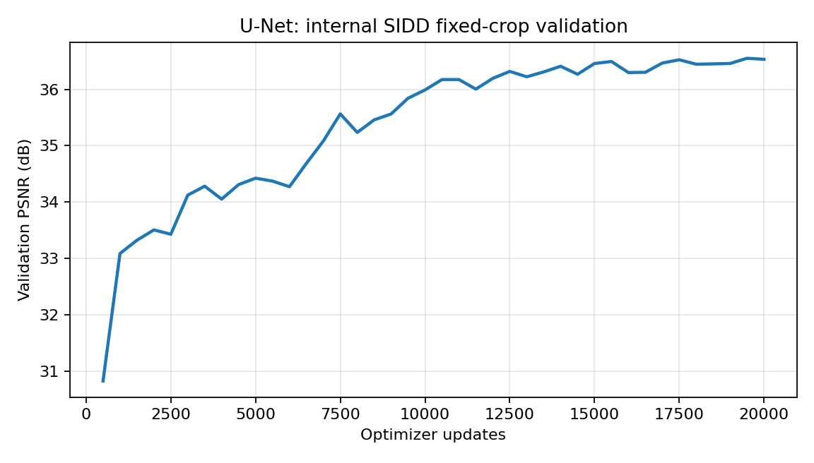
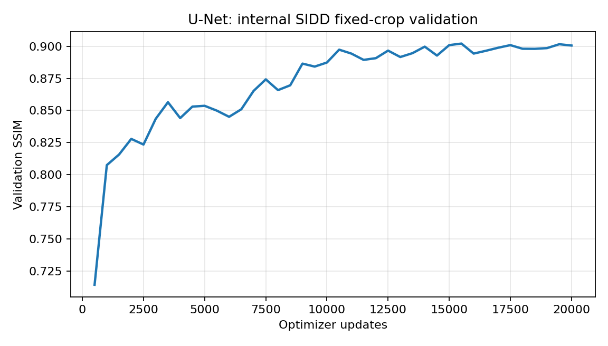
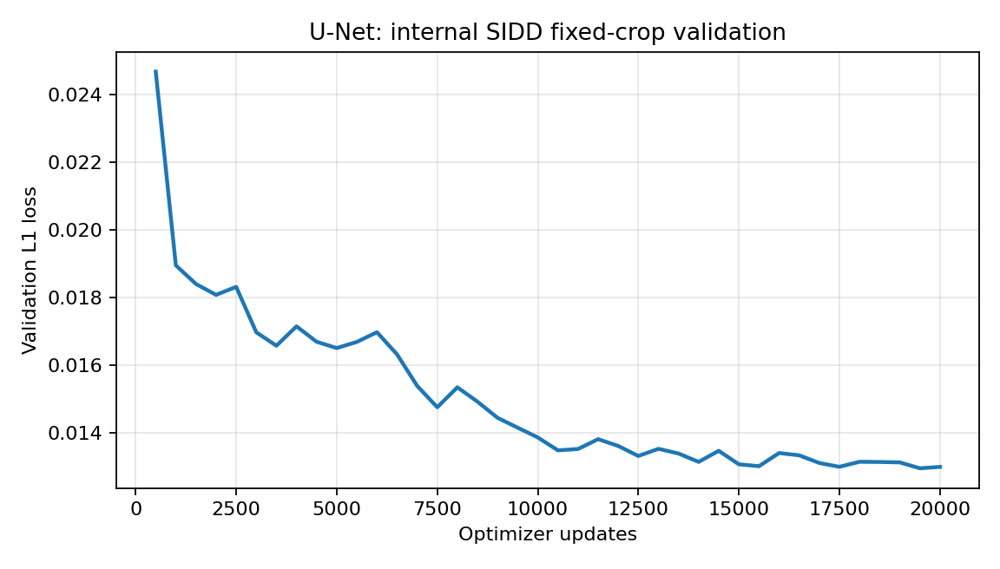

# U-Net for Real-World Image Denoising

**SIDD-Medium sRGB | PyTorch | 20,000-Step Training Experiment**

**U-Net implementation adaptation, complete training execution, checkpoint management, evaluation, and experimental results: @Tanika-git:** [@Tanika-git](https://github.com/Tanika-git)  
**Status:** Training and internal evaluation completed on 3 November 2026

This folder documents a U-Net image-denoising experiment conducted on paired noisy and clean images from SIDD-Medium sRGB. It includes training records, validation curves, checkpoint provenance, and held-out evaluation results.

**[Results](#experimental-results) | [Methodology](#methodology) | [Training evidence](#experiment-files) | [Checkpoint](#model-checkpoint) | [Contributions and attribution](#contributions-and-attribution)**

> **Evaluation scope:** All figures below are from an internal, fixed-crop evaluation protocol. They are **not official SIDD benchmark scores** and should not be compared directly with results from different splits, crops, or metric implementations.

## Experiment summary

| Item | Recorded value |
|---|---|
| Model | U-Net-style RGB restoration network |
| Experiment ID | `sidd_unet_seed42_v1` |
| Full-run session | `s20261103T022106Z_81744e72` |
| Researcher responsible for training | [@Tanika-git](https://github.com/Tanika-git) |
| Dataset | SIDD-Medium sRGB, 320 paired images |
| Completed optimizer updates | **20,000** |
| Training initialization | Continued from an earlier 100-step pilot checkpoint |
| Model parameters | 7,846,723 |
| Training hardware | Kaggle, NVIDIA Tesla T4 |
| Evaluated checkpoint | `step_020000.pt` |
| Experiment date | 3 November 2026 |

## Experimental results

The model was evaluated against paired clean targets using PSNR and SSIM. The validation and test sets contain different scene groups.

| Metric | Validation | Held-out test |
|---|---:|---:|
| Noisy-input PSNR | 27.727 dB | 28.259 dB |
| **Trained U-Net PSNR** | **36.533 dB** | **41.232 dB** |
| PSNR change over noisy input | +8.806 dB | +12.973 dB |
| **Trained U-Net SSIM** | **0.90064** | **0.95286** |

- **Test basis:** 60 fixed 256 x 256 RGB crops from 30 held-out noisy/clean image pairs.
- **Test noisy-input SSIM:** 0.52903.
- **Checkpoint used for testing:** The saved step-20,000 milestone, not a separately selected validation-best checkpoint.
- **Metric calculation:** Outputs were clamped to `[0, 1]`. PSNR and SSIM were calculated per crop and then averaged; SSIM used an 11 x 11 Gaussian window.
- **Evaluation environment:** CPU, PyTorch `2.10.0+cpu`, using saved `test_noisy.npy` and `test_clean.npy` arrays.

**Limit:** The exported test arrays have not yet been independently matched crop-by-crop against the original source-image manifest. Their scene assignment is documented in the experiment configuration but remains to be audited.

### Validation curves

Validation was recorded every 500 successful optimizer steps through step 20,000. These plots show **validation**, not held-out test, performance.

| Validation PSNR | Validation SSIM |
|---|---|
|  |  |



Validation PSNR increased from approximately 30.826 dB at step 500 to 36.533 dB at step 20,000, with fluctuations during training.

## Methodology

### Model

U-Net is an encoder-decoder convolutional architecture with skip connections. In this experiment it predicts a denoised three-channel RGB image, rather than a segmentation mask. The output is compared with the paired clean reference using L1 reconstruction loss.

```text
Noisy sRGB image -> U-Net -> Predicted clean sRGB image
                                  |
Paired clean reference ------------+-> L1 reconstruction loss
```

The model contains **7,846,723 parameters** according to the recorded experiment. The original U-Net architecture and the starting/reference code are acknowledged in [Contributions and attribution](#contributions-and-attribution).

### Dataset and evaluation split

The experiment used the **SIDD-Medium sRGB** release, with 320 noisy/clean image pairs.

| Split | Image pairs | Recorded physical-scene groups |
|---|---:|---|
| Training | 220 | `physical_scene_01`, `02`, `05`, `06`, `07`, `09`, `10` |
| Validation | 70 | `physical_scene_04`, `08` |
| Held-out test | 30 | `physical_scene_03` |
| **Total** | **320** | |

The recorded physical-scene grouping is intended to reduce overlap between training and evaluation content. The archived manifest and its fingerprints define the specific split.

| Stage | Recorded processing |
|---|---|
| Training patch cache | 192 x 192 RGB patches |
| Training input | Random 128 x 128 subcrops |
| Training augmentation | D4-style flips and rotations |
| Validation | Two predetermined 256 x 256 crops per image pair |
| Held-out test | Two predetermined 256 x 256 crops per image pair (60 total) |
| Metric inputs | Floating-point RGB intensities |
| Prediction range | Clamped to `[0, 1]` before evaluation |

### Training configuration

| Setting | Recorded value |
|---|---|
| Seed | `42` |
| Batch size | `4` |
| Loss | L1 / mean absolute error |
| Optimizer | AdamW |
| Initial learning rate | `0.0002` |
| Minimum learning rate | `0.000001` |
| Learning-rate schedule | Cosine decay |
| Mixed precision | CUDA AMP |
| Early stopping | Disabled for the full run |
| Validation frequency | Every 500 optimizer steps |
| Checkpoint milestones | 1K, 5K, 10K, 20K |
| Training PyTorch build | `2.11.0+cu130` |

The recorded history contains **20,000 successful optimizer updates** and **20,007 attempted batches**. Seven AMP-skipped attempts were not counted as successful updates. The run continued from an earlier 100-step pilot checkpoint; it is not claimed to have begun from random initialization at the start of the 20K session.

## Experiment files

The files in this folder preserve the original run evidence. The logs and numeric result files should be kept unchanged.

| File | Purpose |
|---|---|
| [`history.csv`](history.csv) | Full-run validation history, through step 20,000 |
| [`train_log.jsonl`](train_log.jsonl) | Timestamped training events |
| [`run_info.json`](run_info.json) | Configuration, run identity, source revision, and split information |
| [`test_summary.json`](test_summary.json) | Held-out evaluation protocol and aggregate results |
| [`test_per_crop.csv`](test_per_crop.csv) | Per-crop measurements for the 60 test crops |
| [`validation_psnr.png`](validation_psnr.png) | Validation PSNR progression |
| [`validation_ssim.png`](validation_ssim.png) | Validation SSIM progression |
| [`validation_loss.png`](validation_loss.png) | Validation L1 reconstruction loss |
| [`CONTRIBUTIONS_AND_PROVENANCE.md`](CONTRIBUTIONS_AND_PROVENANCE.md) | Detailed research contributions, source attribution, and checkpoint provenance |

**Important:** The original archive also contains an earlier 100-step pilot with different settings. The files in this folder represent the **20K run**; pilot logs should not be substituted for these full-run records.

## Model checkpoint

The evaluated original milestone checkpoint is retained in the private research archive, rather than uploaded to this public evidence folder.

| Property | Recorded value |
|---|---|
| Filename | `step_020000.pt` |
| Experiment ID | `sidd_unet_seed42_v1` |
| Step | `20000` |
| Original size | 94,214,219 bytes |
| Saved (UTC) | `2026-11-03T02:36:06+00:00` |
| Contents | Model, optimizer, scheduler, and AMP scaler states |
| Training and evaluation | [@Tanika-git](https://github.com/Tanika-git) |

**SHA-256 of the original full checkpoint:**

```text
cf4a28c5f97d6b1a4c4a2a6fa256fbc0d51a147c36128d773bf89c43d949e073
```

This digest identifies the **original full checkpoint only**. An inference-only export or another converted model file has a different checksum and should be recorded separately. A checkpoint hash establishes file identity; it does not by itself establish authorship.

## Reproducibility and limitations

The experiment files allow review of the recorded training and evaluation, but this folder is **not a complete one-command reproduction package**. A faithful reproduction additionally requires:

1. The matching adapted Kaggle training notebook or scripts and model definition.
2. Authorized access to the original SIDD-Medium sRGB pairs.
3. The exact scene-based manifest, patch generation, crop selection, and preprocessing.
4. The 100-step pilot state for an identical continuation, or a clearly labeled new run.
5. The correct training configuration and checkpoint-loading logic.
6. The saved final checkpoint and fixed evaluation crops for repeating the recorded inference.

A new run that starts from random initialization, changes crops, or uses another metric implementation is a **different experiment**, even if it uses U-Net and SIDD.

Further work includes auditing the test export against its source manifest, archiving a safely shareable revision of the adapted training notebook, testing an inference entry point, and comparing U-Net with NAFNet under the **same** evaluation protocol.

**Data and file safety:** Do not upload credentials, private dataset exports, or full training-state checkpoints without checking applicable dataset, team, and institutional requirements. Treat untrusted PyTorch checkpoint files as potentially unsafe to load.

## Contributions and attribution
Individual research contribution — @Tanika-git: Independently adapted the U-Net reference implementation for the SIDD-Medium sRGB experiment, prepared and executed the training workflow, completed the pilot and 20,000-step training run, managed the resulting checkpoints, conducted validation and held-out testing, and generated the documented PSNR, SSIM, training histories, graphs, and experimental results.

**U-Net experimental implementation, adaptation, training execution, checkpoint management, validation, held-out evaluation, and results documentation:** **[@Tanika-git](https://github.com/Tanika-git)**.

The researcher adapted the initial reference code, prepared and operated the SIDD-Medium training workflow, completed the pilot and 20,000-step experiment, preserved the training records and checkpoints, and produced the documented evaluation outputs. These are the research contributions attributed to @Tanika-git.

**Reference implementation:** Code was initially provided by research teammate **Nitya Goyal**, from [SOTA-Image-Denoising](https://github.com/nitya-goyal/SOTA-Image-Denoising), recorded at [commit `89c18654`](https://github.com/nitya-goyal/SOTA-Image-Denoising/commit/89c18654b5e034aa7c93dc050fbf6ec15dde9050). The original U-Net architecture and any inherited source components retain their respective author credits. This acknowledgment is separate from credit for the training experiment carried out by @Tanika-git.

**Research collaborators:** **Nitya Goyal** and **Kannu Goyal** are collaborators for the U-Net/NAFNet comparison. Copies of the trained model shared for this research are to be accompanied by the experiment identity, relevant model-loading instructions, and attribution. Exact shared filenames, checksums, and transfer dates should be logged after each transfer.

### Attribution for further use

For any public repository, presentation, paper, model-hosting page, or redistributed copy that uses the trained checkpoint or reported results, the requested experiment attribution is:

> **U-Net denoising model trained and evaluated by @Tanika-git on SIDD-Medium sRGB (November 2026). Original 20,000-step experiment and results: https://github.com/Tanika-git/SIDD-Image-Denoising-S-rgb-medium**

Collaborators are requested to preserve this credit and consult the relevant project members before public redistribution. Attribution embedded in a `.pt` file can be removed; this repository's original checkpoint identity, logs, dated experiment records, and commit history provide independent provenance. These requests do not override existing third-party licenses, prior permissions, or applicable institutional rights.

See [`CONTRIBUTIONS_AND_PROVENANCE.md`](CONTRIBUTIONS_AND_PROVENANCE.md) for the detailed attribution record. The root repository documents the separately completed dataset research and related analysis by @Tanika-git.

## References

1. Abdelhamed, A., Lin, S., and Brown, M. S. (2018). *A High-Quality Denoising Dataset for Smartphone Cameras*. CVPR. [SIDD project](https://abdokamel.github.io/sidd/).
2. Ronneberger, O., Fischer, P., and Brox, T. (2015). *U-Net: Convolutional Networks for Biomedical Image Segmentation*. MICCAI. [Paper](https://arxiv.org/abs/1505.04597).
3. Chen, L., Chu, X., Zhang, X., and Sun, J. (2022). *Simple Baselines for Image Restoration*. ECCV. [NAFNet paper](https://arxiv.org/abs/2204.04676).
4. [Starting source revision: SOTA-Image-Denoising, commit `89c18654`](https://github.com/nitya-goyal/SOTA-Image-Denoising/commit/89c18654b5e034aa7c93dc050fbf6ec15dde9050).
5. [PyTorch documentation](https://pytorch.org/).

*Research experiment completed and documented: 3 November 2026. This README does not grant new rights to third-party code, datasets, or model artifacts.*
